<div align="center">



<br/>

[](https://github.com/HarshilBhuva/PacketHawk/actions/workflows/ci.yml)
[](https://www.rust-lang.org/)
[](LICENSE)
[](https://github.com/HarshilBhuva/PacketHawk/releases/latest)

**Inspect the packets. Reconstruct the story. Surface the evidence.**

PacketHawk is an offline-first network threat analysis engine written in Rust.
It turns saved PCAP/PCAPNG captures into bounded flow summaries and
evidence-backed detection findings — without transmitting capture data or
modifying network traffic.

[Quick start](#-quick-start) · [Capabilities](#-what-it-detects) · [Architecture](#-analysis-pipeline) · [Security](#-security-model) · [Roadmap](#-project-status)

</div>

---

## The idea

Network captures are noisy. PacketHawk gives analysts a repeatable path from
raw capture files to explainable investigative leads.


<div align="center">

| Offline by default | Bounded processing | Evidence first |
|:---:|:---:|:---:|
| No live capture or packet injection | Explicit input, packet, and state limits | Findings include observations and thresholds |

</div>

## What it detects

| Detection | Signal | Analyst context |
|---|---|---|
| Vertical port scan | One source probes many destination ports on a host | Unique destination ports in a time window |
| Horizontal port scan | One source probes the same service port across hosts | Unique destination hosts in a time window |
| Beacon-like traffic | Repeated TCP/UDP conversations with regular intervals | Inter-arrival coefficient of variation |
| DNS query anomaly | Long or high-entropy UDP DNS question names | Heuristic indicator; not proof of tunneling |

Every alert is an investigative lead, not a verdict. PacketHawk reports the
observed values and configured thresholds so an analyst can validate the
signal against the surrounding capture.

## Analysis pipeline


### Current capabilities

- Read classic PCAP and PCAPNG captures incrementally.
- Decode supported Ethernet II, VLAN, Linux cooked, IPv4/IPv6, TCP/UDP/ICMP metadata.
- Bound capture files, packet records, PCAPNG blocks, flow state, and detector state.
- Aggregate directional or bidirectional five-tuple flows.
- Track packet/byte counters, first/last-seen timestamps, duration, idle expiry, and LRU eviction.
- Stream capture records through flow aggregation and detection without retaining the full decoded packet list.
- Count malformed frames, late packets, and state evictions instead of silently hiding those conditions.
- Emit human-readable and JSON output for capture inspection, flow summaries, and detection reports.

### Protocol and analysis limits

- IPv4 non-initial fragments and unsupported IPv6 extension-header chains are skipped; reassembly is not implemented.
- DNS inspection currently extracts UDP DNS question names. DNS-over-TCP, DoH, DoT, and encrypted DNS are not inspected.
- Beaconing and scan findings are heuristic; confidence is not a calibrated probability.
- No live capture, active scanning, packet injection, traffic blocking, or automated response.

## Quick start

**Requirements:** Rust 1.85 or newer.

```bash
git clone https://github.com/HarshilBhuva/PacketHawk.git
cd PacketHawk

cargo build --locked
cargo test --locked
cargo run --locked -- --help
```

Inspect a capture:

```bash
# Packet and capture metadata
cargo run -- capture inspect sample.pcap

# Flow summaries as JSON
cargo run -- capture flows sample.pcap --json

# Evidence-backed detection report
cargo run -- capture detect sample.pcap

# Use a custom detection configuration
cargo run -- capture detect sample.pcap \
  --config config/default.toml --json
```

Validate the default configuration:

```bash
cargo run -- config check config/default.toml
```

## Configuration

Detection thresholds and state limits are defined in
[`config/default.toml`](config/default.toml). Keep configuration under version
control with the capture-analysis procedure so that results are reproducible.
The engine validates configuration before analysis.

## Performance

Criterion benchmarks cover PCAP ingestion, flow aggregation, and detection
using deterministic synthetic workloads.

```bash
cargo bench --locked
REPEATS=5 ./scripts/benchmark-report.sh
```

See [the benchmark guide](docs/BENCHMARKS.md) for the benchmark cases,
environment capture, and interpretation. CI artifacts are useful for
before/after comparisons, but hosted runners are not a controlled hardware
baseline. Do not compare absolute numbers across different runner types.

## Development

```bash
cargo fmt --all -- --check
cargo clippy --locked --all-targets --all-features -- -D warnings
cargo test --locked --all-targets
cargo bench --locked --no-run
cargo deny check licenses bans sources
cargo build --locked --release
```

## Project status

| Milestone | Scope | Status |
|---|---|---|
| M0–M1 | Rust foundation, configuration, offline PCAP/PCAPNG ingestion | Complete |
| M2 | Bounded directional and bidirectional flow aggregation | Complete |
| M3–M5 | Port-scan, beacon-like, and DNS anomaly detections | Complete |
| M6 | Criterion benchmark suites and CI artifacts | Complete |
| M7–M9 | Streaming PCAP/PCAPNG analysis and bounded detector state | Complete |
| M10–M11 | Release hardening, dependency audit, license policy, pinned Actions | Complete |
| M12 | Controlled reference benchmark and v0.1.0 release verification | Complete |

The project is an early-stage defensive analysis tool. **v0.1.0 is released**
for Linux x86_64. The tagged archive was built, extracted, smoke-tested, and
published with a SHA-256 checksum file. See the [GitHub Release](https://github.com/HarshilBhuva/PacketHawk/releases/tag/v0.1.0)
and [`docs/RELEASE_CHECKLIST.md`](docs/RELEASE_CHECKLIST.md).

## Security

Treat captures and configuration as untrusted input. PacketHawk applies
explicit resource bounds and validates malformed/truncated data. These
protections reduce risk but do not make arbitrary files risk-free.

For vulnerability reporting and supported security expectations, see
[`SECURITY.md`](SECURITY.md).

## Contributing

Issues and focused pull requests are welcome. Keep changes scoped, add
regression tests for parser or detection behavior, and include benchmark
evidence when changing hot paths. See [`CONTRIBUTING.md`](CONTRIBUTING.md).

## License

MIT — see [`LICENSE`](LICENSE).

<div align="center">

**PacketHawk · Capture. Correlate. Investigate.**

</div>
