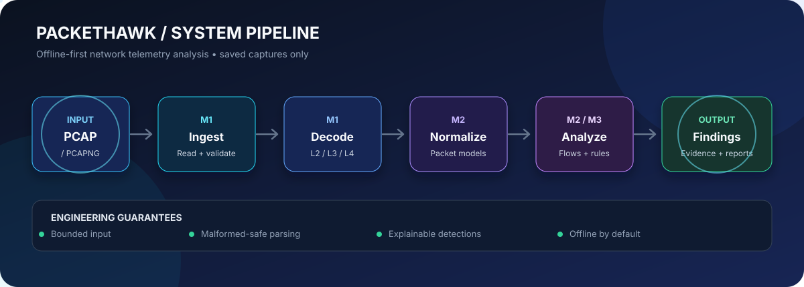

# PacketHawk

**An offline-first network threat analysis engine written in Rust.**

PacketHawk inspects PCAP/PCAPNG captures, normalizes packet metadata, reconstructs network flows, identifies suspicious traffic patterns, and produces evidence-backed security alerts.

> **Development status:** M2 implements bounded flow aggregation on top of offline capture ingestion. Detection rules are the next milestone.

## How PacketHawk works

PacketHawk is designed as an offline analysis pipeline. It starts with a saved capture, safely decodes supported network layers, builds bounded bidirectional or directional flow records, and will progressively add explainable detection rules.



### Analyst workflow


## Current capabilities

- Read classic PCAP (little-/big-endian, microsecond/nanosecond timestamps).
- Read PCAPNG section, interface, enhanced packet, and simple packet blocks.
- Decode Ethernet II, up to two VLAN tags, Linux cooked capture, and raw IP link types.
- Extract IPv4/IPv6 addresses and TCP/UDP/ICMP metadata.
- Count unsupported or malformed packet frames without panicking.
- Cap input capture size at 512 MiB.
- Print a concise or JSON capture-ingestion summary.
- Aggregate packets into bounded directional or bidirectional five-tuple flows.
- Track packet/byte counters, forward/reverse traffic, first/last seen timestamps, and duration.
- Expire idle flows and evict the least-recently-seen flow at the configured capacity.

## Getting started

Install a stable Rust toolchain, then:

```bash
git clone https://github.com/HarshilBhuva/PacketHawk.git
cd PacketHawk
cargo build
cargo test
cargo run -- --help
```

Inspect a capture:

```bash
cargo run -- capture inspect sample.pcap
cargo run -- capture inspect sample.pcapng --json
```

Summarize flows:

```bash
cargo run -- capture flows sample.pcap
cargo run -- capture flows sample.pcap --max-active-flows 50000 --idle-timeout-secs 90
cargo run -- capture flows sample.pcap --directional --json
```

Validate the example configuration:

```bash
cargo run -- config check config/default.toml
```

## Development checks

```bash
cargo fmt --all -- --check
cargo clippy --all-targets --all-features -- -D warnings
cargo test --all-targets
cargo build --release
```

## Roadmap

| Milestone | Scope | Status |
|---|---|---|
| M0 | Project foundation, models, configuration, CI | Complete |
| M1 | PCAP/PCAPNG ingestion and packet parsing | Complete |
| M2 | Bounded flow aggregation and statistics | Implemented in this branch |
| M3 | Port-scan, DNS, and beaconing detections | Next |
| M4 | JSON reports, fixtures, and reliability hardening | Planned |
| M5 | Benchmarks, documentation, and v0.1.0 release | Planned |

## Flow model and limitations

Flows are keyed by the five-tuple (source/destination IP, source/destination port, protocol). Bidirectional mode canonicalizes endpoint order and records forward/reverse counters; directional mode keeps each direction separate. The table is bounded by `--max-active-flows`; when full, the least-recently-seen flow is evicted. Idle expiry uses capture timestamps and a monotonic maximum timestamp watermark, so out-of-order packet timestamps do not move flow recency backwards.

The first release aggregates packets already decoded by the capture reader. It does not perform TCP stream reassembly, IP fragment reassembly, application-layer session reconstruction, or active network capture. Flow records are investigative context, not proof of malicious activity.

## Protocol coverage and limitations

The first parser supports Ethernet II (including up to two VLAN tags), Linux cooked capture, and raw IPv4/IPv6 link types. It extracts basic IPv4/IPv6 and TCP/UDP/ICMP metadata. IPv4 non-initial fragments and IPv6 extension-header chains are skipped rather than partially decoded. Unsupported link types are rejected. Packet-level parse failures are counted in the capture report; structural capture corruption returns an error.

Heuristic findings will be indicators for analyst review, not definitive attribution or proof of compromise.

## License

MIT. See [LICENSE](LICENSE).
